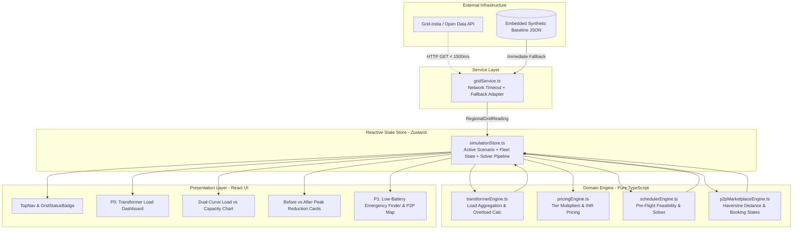
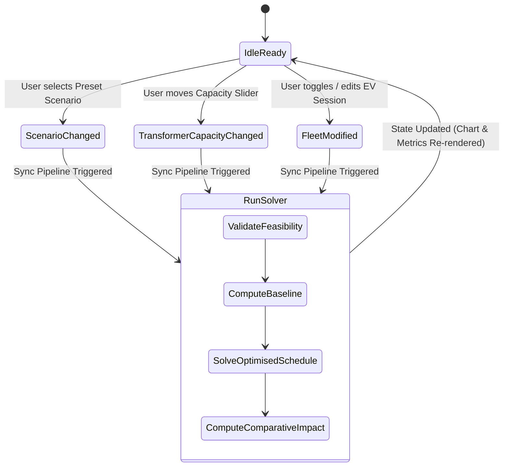

# CHARGESHARE — SPECIFICATION D03
# Technical Architecture & System Design
**Document ID:** D03  
**Version:** 1.0 (Target Implementation Architecture)  
**PRD Reference:** [ChargeShare_PRD_Final_v2_1.docx](file:///c:/Users/sysye/OneDrive/Desktop/EVkal/ChargeShare_PRD_Final_v2_1.docx)  
**Data & Math Reference:** [D02_Data_API_Algorithm_Specification.md](file:///c:/Users/sysye/OneDrive/Desktop/EVkal/D02_Data_API_Algorithm_Specification.md)  
**Status:** Ready for Engineering Implementation  
**Release Date:** 23 October 2026  

---

## 1. Architectural Mission & Core Tenets

ChargeShare is an interactive decision-support web application engineered for **Hackathon Problem #053**. Its architecture is built around three non-negotiable architectural tenets:

1. **Deterministic Domain Core (Zero UI Math)**: All electrical calculations, transformer simulations, demand tier categorizations, dynamic pricing, and scheduling solvers reside in pure, framework-agnostic TypeScript domain engines. The UI layer strictly consumes computed data.
2. **Resilient Data Decoupling**: Regional macro-grid inputs and local transformer telemetry are decoupled. The system maintains an active network timeout threshold (1,500ms). When offline or upon network failure, the application immediately switches to the embedded synthetic demonstration baseline with zero runtime disruption and full provenance disclosure.
3. **Strict P0/P1 Isolation**: The P0 Smart Charging Core and the P1 P2P Sharing Extension share common domain types but operate as independent feature modules. A failure or missing field in the P1 marketplace cannot degrade the P0 grid optimization demo.

---

## 2. Technology Stack Selection & Rationales

| Layer | Technology | Version | Rationale |
| :--- | :--- | :--- | :--- |
| **Runtime & Language** | TypeScript | `~5.7` | Explicit TypeScript interfaces establish clear schema contracts across all domain boundaries, pairing clean scalar `number` values with documented semantic units ($\text{kW}, \text{kWh}, \text{hours}, ₹$) and runtime validators. |
| **Application Framework** | React + Vite | `React 19`, `Vite 6` | Ultra-fast HMR, sub-second cold starts, zero-config client build, optimal for live judge demos on standard laptops. |
| **State Management** | Zustand | `~5.0` | Minimal boilerplate, framework-agnostic store access, unopinionated reactive subscriptions for real-time recalculation pipelines. |
| **Styling & Design System** | Tailwind CSS | `v3.4` / `v4` | High-aesthetic dark-mode tokens for energy states (Emerald, Blue, Amber, Rose) with zero runtime CSS overhead. |
| **Data Visualization** | Chart.js + react-chartjs-2 | `^4.4` | High-performance canvas rendering for dual-curve 24-hour load profiles, capacity threshold dashed lines, and dynamic overload danger fills. |
| **UI Iconography** | Lucide React | `^0.47` | Crisp, modern icons for EV connectors, battery gauges, grid alerts, and navigation. |
| **Deployment Target** | Static SPA (Vercel / Netlify / Local) | Node 20+ | Client-side execution with zero external server dependencies, guaranteeing 100% demo uptime. |

---

## 3. High-Level System Architecture

The following diagram illustrates the unidirectional data flow across the four architectural boundaries:



---

## 4. Complete Project Directory Layout

```
c:\Users\sysye\OneDrive\Desktop\EVkal\
├── index.html                               # HTML5 entry with metadata & font imports
├── package.json                             # Dependencies, scripts (dev, build, preview)
├── tsconfig.json                            # Strict TypeScript compilation rules
├── vite.config.ts                           # Vite configuration with alias paths
├── tailwind.config.js                       # Energy domain colors & dark-mode theme
├── src/
│   ├── main.tsx                             # React root mount point
│   ├── App.tsx                              # Root shell, mode switcher (P0 Grid vs P1 Sharing)
│   ├── index.css                            # Base Tailwind styles & custom chart animations
│   │
│   ├── types/                               # Canonical TypeScript definitions (matching D02)
│   │   ├── grid.ts                          # RegionalGridReading, DataProvenance, GridStress
│   │   ├── transformer.ts                   # TransformerConfig, SlotLoadRecord, LocalTier
│   │   ├── evSession.ts                     # EVSessionInput, FeasibilityResult, SolverPlan
│   │   ├── pricing.ts                       # PricingConfig, DynamicRateSlot
│   │   └── p2p.ts                           # ChargerListing, ConnectorType, BookingRequest
│   │
│   ├── data/                                # Deterministic demonstration datasets
│   │   ├── syntheticGridProfile.json        # 24-hr Indian regional demand baseline (MW)
│   │   ├── residentialBackgroundLoad.json   # 24-hr non-EV residential load profile (kW)
│   │   ├── benchmarkScenarios.json          # Pre-configured fleet scenarios (Rush, Shift, Infeasible)
│   │   └── sampleChargerListings.json       # Seed P2P host listings with geo-coordinates
│   │
│   ├── services/                            # External data integration
│   │   └── gridService.ts                   # Fetch with 1500ms timeout & fallback guarantee
│   │
│   ├── domain/                              # Pure mathematical & algorithmic logic
│   │   ├── transformerEngine.ts             # Background + EV summation, utilisation & overload
│   │   ├── pricingEngine.ts                 # Local demand tier assignment & INR rate computation
│   │   ├── feasibilityValidator.ts          # Pre-flight energy/deadline validation
│   │   ├── schedulerEngine.ts               # Normalized valley-filling smart charging solver
│   │   └── p2pMarketplaceEngine.ts          # Haversine distance, compatibility & booking lifecycle
│   │
│   ├── store/                               # State management
│   │   └── useSimulationStore.ts            # Central Zustand store driving the application
│   │
│   ├── components/                          # React visual components
│   │   ├── common/                          # Reusable UI primitives
│   │   │   ├── Badge.tsx                    # Color-coded tier badges (Low, Med, High, Crit)
│   │   │   ├── Card.tsx                     # Glassmorphic container panels
│   │   │   ├── Button.tsx                   # Accessible primary/secondary action triggers
│   │   │   └── ProvenanceTag.tsx            # Explicit "LIVE API" vs "SYNTHETIC" badges
│   │   │
│   │   ├── layout/                          # Global chrome
│   │   │   ├── Header.tsx                   # Brand, live clock, regional grid stress indicator
│   │   │   └── ModeTabs.tsx                 # Toggle between [Smart Grid P0] and [P2P Sharing P1]
│   │   │
│   │   ├── p0-smart-charging/               # P0 MVP Dashboard Components
│   │   │   ├── TransformerControlPanel.tsx  # Sliders for capacity (kW) & safety threshold
│   │   │   ├── ScenarioSelector.tsx         # Quick-load buttons (Evening Rush, Night Shift, Infeasible)
│   │   │   ├── DualCurveLoadChart.tsx       # Core Chart.js Baseline vs Optimised canvas
│   │   │   ├── BeforeAfterMetricsCard.tsx   # Peak reduction %, overload avoided kWh, cost saved
│   │   │   ├── HourlyScheduleHeatmap.tsx    # 24-hour visual block matrix of fleet power
│   │   │   └── EVFleetManagerTable.tsx      # Table of vehicles, arrival, deadline, edit modal
│   │   │
│   │   └── p1-charger-sharing/              # P1 Extension Components
│   │       ├── LowBatteryHeroInput.tsx      # Battery %, range km, connector selector
│   │       ├── NearbyChargerCard.tsx        # Listing card with distance, power, price, host badge
│   │       ├── ChargerMapPlaceholder.tsx    # Clean stylized vector radar / radius visualizer
│   │       └── BookingSimModal.tsx          # 7-state booking transition dialogue
│   │
│   └── utils/                               # Helper utilities
│       ├── formatters.ts                    # kW, kWh, ₹ currency, and time formatting helpers
│       └── geo.ts                           # Haversine straight-line distance calculation
```

---

## 5. Domain Engine Module Contracts & Specifications

### 5.1 Transformer Engine (`domain/transformerEngine.ts`)
A pure, side-effect-free module responsible for calculating total load, utilisation percentage, and overload energy.

```typescript
export interface TransformerSimulationOutput {
  hourlyRecords: SlotLoadRecord[];
  peakLoadKw: number;
  peakHour: number;
  maxUtilisationPct: number;
  totalEnergyDeliveredKwh: number;
  overloadHoursCount: number;
  totalOverloadEnergyKwh: number;
}

export function computeTransformerLoadProfile(
  capacityKw: number,
  backgroundLoad: BackgroundLoadSlot[],
  evFleet: EVSessionInput[],
  scheduleMatrix: Record<string, number[]> // [sessionId][hour] -> powerKw
): TransformerSimulationOutput;
```
- **Invariant**: $\text{TotalLoad}(t) = \text{BackgroundLoad}(t) + \sum_{i} \text{power}_i(t)$.
- **Complexity**: $O(T \times N)$ where $T = 24$, $N \le 50$ (Executes in $< 0.2\text{ ms}$).

### 5.2 Pricing Engine (`domain/pricingEngine.ts`)
Maps hourly transformer loads to local demand tiers and calculates the illustrative INR rate.

```typescript
export function classifyLocalTier(utilisationPct: number): LocalTransformerTier {
  if (utilisationPct < 50.0) return 'LOCAL_OFF_PEAK';
  if (utilisationPct < 75.0) return 'LOCAL_NORMAL';
  if (utilisationPct <= 100.0) return 'LOCAL_CONGESTED';
  return 'LOCAL_OVERLOAD';
}

export function calculateHourlyIllustrativeRate(
  localTier: LocalTransformerTier,
  regionalStress: 'REGIONAL_LOW' | 'REGIONAL_NORMAL' | 'REGIONAL_HIGH' | 'REGIONAL_CRITICAL'
): number;
```

### 5.3 Smart Scheduler Engine (`domain/schedulerEngine.ts`)
Implements the normalized dimensionless valley-filling solver defined in D02 Section 6.

```typescript
export interface OptimizationResult {
  optimisedScheduleMatrix: Record<string, number[]>; // [sessionId][24] -> kw
  uncoordinatedScheduleMatrix: Record<string, number[]>;
  impact: ScheduleImpactSummary;
  scheduleStatus: 'OPTIMAL_RESOLVED' | 'MITIGATED_PARTIAL_OVERLOAD' | 'INFEASIBLE_UNMET_ENERGY';
  feasibilityIssues: Record<string, FeasibilityCheckResult>;
}

export function runSmartChargingOptimization(
  transformerCapacityKw: number,
  backgroundLoad: BackgroundLoadSlot[],
  evFleet: EVSessionInput[],
  regionalStressProfile: HourlyRegionalProfile[]
): OptimizationResult;
```
- **Solver Step 1**: Execute `validateChargingFeasibility` for each vehicle. If infeasible, flag vehicle and emit actionable error.
- **Solver Step 2**: Build uncoordinated baseline matrix (vehicles charge immediately at $P_{\max}$ upon arrival).
- **Solver Step 3**: For flexible vehicles, rank candidate window slots using dimensionless score $S(t) = 0.65 \cdot U_{\text{norm}}(t) + 0.35 \cdot R_{\text{norm}}(t)$.
- **Solver Step 4**: Greedily assign power in ascending order of $S(t)$ up to transformer capacity headroom.
- **Solver Step 5**: If capacity is exhausted but energy remains, allocate into least-stressed slots and set status to `MITIGATED_PARTIAL_OVERLOAD`.

### 5.4 P2P Marketplace Engine (`domain/p2pMarketplaceEngine.ts`)
Filters host listings by connector compatibility and straight-line Haversine distance, enforcing demo disclaimers.

```typescript
export function searchNearbyChargers(
  query: LowBatterySearchQuery,
  allListings: ChargerListing[]
): NearbyChargerSearchResult[];

export function transitionBookingState(
  currentStatus: BookingStatus,
  action: 'REQUEST' | 'ACCEPT' | 'DECLINE' | 'START_CHARGING' | 'COMPLETE' | 'CANCEL'
): BookingStatus;
```

---

## 6. Reactive State Architecture (Zustand Store)

The entire application state is centralized in a single typed store (`store/useSimulationStore.ts`). Any state mutation (e.g., slider change, EV edit, scenario switch) immediately re-runs the domain solver synchronously.



### Store State Shape:
```typescript
interface SimulationStoreState {
  // Regional External State
  regionalGrid: RegionalGridReading;
  isRegionalLoading: boolean;

  // Transformer Configuration State
  transformerConfig: TransformerConfig;
  backgroundLoad: BackgroundLoadSlot[];

  // EV Fleet & Scheduling State
  evFleet: EVSessionInput[];
  selectedScenarioId: string;
  baselineSimulation: TransformerSimulationOutput | null;
  optimisedSimulation: TransformerSimulationOutput | null;
  scheduleImpact: ScheduleImpactSummary | null;
  solverStatus: 'OPTIMAL_RESOLVED' | 'MITIGATED_PARTIAL_OVERLOAD' | 'INFEASIBLE_UNMET_ENERGY';

  // P1 Extension State
  p2pListings: ChargerListing[];
  activeSearchQuery: LowBatterySearchQuery;
  activeBooking: {
    listingId: string;
    status: BookingStatus;
  } | null;

  // Actions
  fetchRegionalGridData: () => Promise<void>;
  setTransformerCapacity: (newCapacityKw: number) => void;
  loadScenario: (scenarioId: string) => void;
  updateEVSession: (updatedSession: EVSessionInput) => void;
  recomputeOptimization: () => void;
  submitP2PBookingRequest: (listingId: string) => void;
  updateBookingStatus: (newStatus: BookingStatus) => void;
}
```

---

## 7. User Interface Layout & Component Hierarchy

The UI layout is engineered specifically for a high-impact hackathon demo:

```
┌────────────────────────────────────────────────────────────────────────────────────────┐
│  CHARGESHARE  |  [Status: LIVE API (Grid-India) / SYNTHETIC] | [Time: 19:00 IST]       │
│  Mode: [● Smart Grid Optimizer (P0)]  [  P2P Charger Sharing (P1)  ]                  │
├────────────────────────────────────────────────────────┬───────────────────────────────┤
│ LEFT PANEL: CONTROLS & FLEET (35%)                     │ RIGHT PANEL: ANALYTICS (65%)  │
│ ┌────────────────────────────────────────────────────┐ │ ┌───────────────────────────┐ │
│ │ Transformer Levers                                 │ │ │ BEFORE vs AFTER IMPACT    │ │
│ │ • Rated Capacity: [ 100 kW ] (Slider: 50-200 kW)   │ │ │ • Peak: 122.8 kW → 79.2kW │ │
│ │ • Safety Margin:  [ 90%  ]                         │ │ │ • Reduction:  35.5%       │ │
│ ├────────────────────────────────────────────────────┤ │ │ • Overload:  0.0 kW (100%)│ │
│ │ Benchmark Scenario Presets                         │ │ └───────────────────────────┘ │
│ │ [ Evening Rush (Peak Overload) ]                   │ │ ┌───────────────────────────┐ │
│ │ [ Night Valley Shift (Clean 100% Resolved) ]       │ │ │ 24-HOUR DUAL LOAD CURVE   │ │
│ │ [ Infeasible Deadline Conflict ]                   │ │ │                           │ │
│ ├────────────────────────────────────────────────────┤ │ │  Load (kW)                │ │
│ │ EV Fleet Sessions (7 Vehicles)                     │ │ │   140 ┤        ┌- Baseline│ │
│ │ • Tata Nexon EV  (22 kWh) [Flex: ON] [Edit]        │ │ │   100 ┼────────┼─ Capacity│ │
│ │ • Ioniq 5        (33 kWh) [Flex: ON] [Edit]        │ │ │    80 ┤  /\_/\ └─ Schedule│ │
│ │ • Tiago EV       (14 kWh) [Flex: OFF][Edit]        │ │ │    20 ┤_/     \___________│ │
│ │ [+ Add EV Session]                                 │ │ │       00 06 12 18 23 Hour │ │
│ └────────────────────────────────────────────────────┘ │ └───────────────────────────┘ │
│                                                        │ ┌───────────────────────────┐ │
│                                                        │ │ HOURLY LOAD & PRICING TABLE│ │
│                                                        │ │ Hour 19: ₹11.20 | 79.2 kW  │ │
│                                                        │ └───────────────────────────┘ │
└────────────────────────────────────────────────────────┴───────────────────────────────┘
```

---

## 8. Data Honesty & Guardrails Implementation Contract

The codebase enforces visual and textual disclosures through designated UI elements:

1. **Source Badging**:
   - Every grid reading renders `<ProvenanceTag />`:
     - If `LIVE_API`: Emerald background with `"LIVE API: Grid-India Open Data"`.
     - If `SYNTHETIC_FALLBACK`: Amber outline badge with `"DEMO BASELINE: Synthetic Indian Diurnal Profile"`.
2. **Pricing Disclaimers**:
   - The pricing table footer automatically binds:
     *`"Illustrative time-of-day model for demand-shifting evaluation. Not an official DISCOM tariff."`*
3. **P1 Location Privacy Obfuscation**:
   - In P1, listing coordinates are deliberately jittered by $\pm 350\text{m}$.
   - Address displays as `"Approximate vicinity of Sector 4 (Exact address unlocked upon host acceptance)"`.
4. **Range Estimate Honesty**:
   - Low-battery modal displays:
     *`"Warning: Battery percentage is an approximation. Real-world range depends on driving speed, HVAC, and traffic. Straight-line distance shown."`*

---

## 9. Verification & Acceptance Sign-Off for D03

- [x] Complete directory tree specified with explicit module responsibilities.
- [x] Zero-UI-math rule enforced; all calculations delegated to domain modules.
- [x] State flow fully mapped with synchronous recalculation lifecycle.
- [x] UI component hierarchy and dual-curve chart specification documented.
- [x] Data honesty badges and privacy guardrails integrated directly into UI components.
- [x] Stack pinned to React 19, TypeScript 5.7, Tailwind CSS, and Chart.js.
