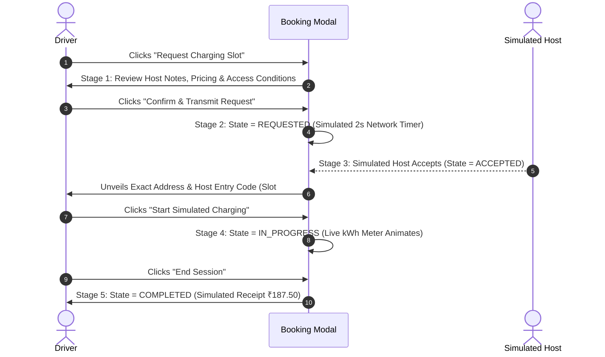

# CHARGESHARE — SPECIFICATION D04
# UI/UX & Screen Interaction Specification
**Document ID:** D04  
**Version:** 1.0 (Implementation Baseline)  
**PRD Reference:** [ChargeShare_PRD_Final_v2_1.docx](file:///c:/Users/sysye/OneDrive/Desktop/EVkal/ChargeShare_PRD_Final_v2_1.docx)  
**Data & Math Reference:** [D02_Data_API_Algorithm_Specification.md](file:///c:/Users/sysye/OneDrive/Desktop/EVkal/D02_Data_API_Algorithm_Specification.md)  
**Technical Architecture:** [D03_Technical_Architecture_System_Design.md](file:///c:/Users/sysye/OneDrive/Desktop/EVkal/D03_Technical_Architecture_System_Design.md)  
**Status:** Approved for Implementation  
**Release Date:** 23 October 2026  

---

## 1. Design Philosophy & Visual Identity

ChargeShare is designed to impress hackathon judges within the first 15 seconds through an industrial, high-precision dark-mode interface modeled after modern energy command centers (e.g., Tesla Energy, Rivian FleetOS, National Grid Control).

### 1.1 Core Aesthetic Guidelines
- **Theme**: Deep slate/zinc dark mode (`#0B0F17`, `#111827`, `#1F2937`) with subtle glassmorphic translucent panels (`bg-slate-900/80 backdrop-blur-md border border-slate-800`).
- **Telemetry Color System**:
  - `Off-Peak / Safe`: Vibrant Emerald (`#10B981`) — spare capacity, clean energy, successful optimization.
  - `Normal Operation`: Electric Blue (`#3B82F6`) — standard residential baseline load.
  - `Congestion Warning`: Warm Amber (`#F59E0B`) — nearing transformer rated capacity ($75\% - 100\%$).
  - `Critical Overload`: Vivid Crimson (`#EF4444`) — active overload ($> 100\%$), danger zones.
- **Typography Scale**:
  - Primary UI: `Inter` or `Plus Jakarta Sans` (400, 500, 600, 700).
  - Telemetry & Numbers: `JetBrains Mono` or `Roboto Mono` for numbers, hours, kW, kWh, and ₹ values.
- **Immediate Understanding**: Every chart line is labeled directly with an inline legend; judges must not have to search for what a curve means.

---

## 2. Global Shell & Navigation Anatomy

The global application shell persists across all views:

```
┌──────────────────────────────────────────────────────────────────────────────────────────────┐
│ [⚡ CHARGESHARE]  Smart EV Decision Support  │ [● LIVE: Grid-India] [🕒 19:00 IST] [Help ?]  │
├──────────────────────────────────────────────────────────────────────────────────────────────┤
│ Navigation Tabs: [ ⚡ Grid & Transformer Optimizer (P0) ]   [ 📍 P2P Charger Sharing (P1) ]   │
└──────────────────────────────────────────────────────────────────────────────────────────────┘
```

### 2.1 Header Elements
1. **Brand Identity**: Stylized lightning icon with gradient text `ChargeShare`.
2. **Provenance Status Pill (`<ProvenanceTag />`)**:
   - Live Mode: `bg-emerald-950/80 text-emerald-400 border-emerald-800` with pulsating green dot: `"LIVE API: Grid-India (NR)"`.
   - Fallback Mode: `bg-amber-950/80 text-amber-400 border-amber-800`: `"DEMO BASELINE: Synthetic Indian Diurnal Curve"`.
   - Tooltip reveals API latency, timestamp, and fallback trigger status.
3. **Regional Grid Stress Badge**: Real-time macro-status (`REGIONAL_LOW`, `REGIONAL_NORMAL`, `REGIONAL_HIGH`, `REGIONAL_CRITICAL`) reflecting state-level generation balance.
4. **Mode Navigation Bar**: Pill-shaped segment controller toggling between **P0 Smart Grid Optimizer** and **P1 P2P Charger Sharing**.

---

## 3. Screen 1: P0 Smart Charging & Transformer Optimizer (Core MVP)

Screen 1 is a dual-panel command center divided into **Interactive Controls & Fleet (Left 35%)** and **Real-Time Analytics & Load Visualization (Right 65%)**.

```
┌───────────────────────────────────────────────────┬─────────────────────────────────────────────────────────┐
│ LEFT PANEL: SIMULATION CONTROLS & FLEET (35%)     │ RIGHT PANEL: ANALYTICS & VISUALIZATION (65%)            │
├───────────────────────────────────────────────────┼─────────────────────────────────────────────────────────┤
│ 1. Transformer Capacity & Feeder Levers           │ 4. Executive KPI Impact Cards                           │
│    • Capacity: [───●──────────] 100.0 kW          │    ┌──────────────┬──────────────┬──────────────────┐   │
│    • Safety Margin: 90% (90.0 kW)                 │    │ Peak Drop    │ Peak Reduct. │ Overload Avoided │   │
│    • Connected Homes: 25 Residential              │    │ 122.8 → 79.2 │   35.5%      │  100% (41.9 kWh) │   │
│                                                   │    └──────────────┴──────────────┴──────────────────┘   │
│ 2. One-Click Benchmark Scenarios                  │ 5. Dual-Curve 24-Hour Load Chart                        │
│    [🔥 Evening Rush]  [🌙 Valley Shift] [⚠️ Fail] │    140kW ┤                ┌-- Baseline Uncoordinated    │
│                                                   │    122kW ┼───────OVERLOAD─┼─▲ (122.8 kW Peak)           │
│ 3. EV Fleet Sessions (7 Vehicles)                 │    100kW ├───────────────-┼─▼- Rated Capacity (100 kW)  │
│    ┌────────────────────────────────────────────┐ │     79kW ┤          /\__/\└─■ Optimised Schedule        │
│    │ Tata Nexon EV | 22 kWh | Arr 18 | Dep 07   │ │     20kW ┤_________/      \________________________     │
│    │ [Opt-In Smart Scheduling: ON]     [Edit ✏] │ │          00 02 04 06 08 10 12 14 16 18 20 22 Hour       │
│    ├────────────────────────────────────────────┤ │                                                         │
│    │ Hyundai Ioniq 5 | 33 kWh | Arr 19 | Dep 07 │ │ 6. 24-Hour Slot Timeline & Illustrative Tariff Strip   │
│    │ [Opt-In Smart Scheduling: ON]     [Edit ✏] │ │    Hour: [ 17 | 18 | 19 | 20 | 21 | 22 | 23 | 00..04 ]  │
│    ├────────────────────────────────────────────┤ │    Rate: [₹7  |₹11 |₹11 |₹11 | ₹7 | ₹3.8|₹3.3| ₹3.35 ]   │
│    │ Tata Tiago EV | 14 kWh | Arr 20 | Dep 06   │ │    Tier: [NORM|CONG|CONG|CONG|NORM|OFF-PK|OFF-PK|OFF-PK ]│
│    │ [Opt-In Smart Scheduling: OFF]    [Edit ✏] │ └─────────────────────────────────────────────────────────┘
│    └────────────────────────────────────────────┘ │ Disclaimer: Illustrative demand-responsive tariff model.
│    [ + Add EV Vehicle Session ]                   │ Not an official DISCOM regulatory billing schedule.     │
└───────────────────────────────────────────────────┴─────────────────────────────────────────────────────────┘
```

### 3.1 Control Components (Left Panel)

#### Component 1: `<TransformerControlPanel />`
- **Slider**: Range $50\text{ kW}$ to $200\text{ kW}$ in $5\text{ kW}$ increments. Default = $100.0\text{ kW}$.
- **Live Utilization Radial Ring**: Displays real-time peak utilization percentage with dynamic color shifts (Green $<75\%$, Amber $75-100\%$, Red $>100\%$).
- **Instant Response**: Moving the slider dispatches `setTransformerCapacity()` and triggers synchronous recalculation in $<2\text{ ms}$.

#### Component 2: `<ScenarioSelector />`
Three distinct button pills allowing judges to instantly evaluate reproducible states:
1. **`🔥 Evening Rush (Baseline Overload)`**:
   - 7 neighborhood EVs arrive between 18:00 and 20:00.
   - Triggers simultaneous uncoordinated charging $\implies$ **$122.80\text{ kW}$ overload at Hour 19 ($122.80\%$ capacity)**.
2. **`🌙 Valley Shift (Feasible Optimization)`**:
   - Demonstrates smart scheduler shifting 5 flexible vehicles (`EV-01`, `EV-03`, `EV-04`, `EV-05`, `EV-06`) into overnight valley slots (23:00 to 05:00).
   - Peak collapses to **$79.20\text{ kW}$ ($35.5\%$ reduction, $0$ overload hours)**.
3. **`⚠️ Constrained Infeasible Request`**:
   - Adds an EV requiring $25.0\text{ kWh}$ with an impossible 3-hour departure deadline at $3.3\text{ kW}$ (arrival 19:00, deadline 22:00, $\eta = 0.92$).
   - Triggers pre-flight validation failure with actionable error alert: *"Cannot deliver 25.0 kWh in 3 hours at 3.3 kW (Max deliverable: 9.1 kWh). Extend departure deadline by 6 hours (to 04:00) or upgrade to a 7.4 kW charger."*

#### Component 3: `<EVFleetManagerTable />`
- Displays individual vehicles with battery size, initial SoC, target SoC, arrival hour, departure deadline, and flexibility status.
- **Smart Flexibility Toggle Switch**: Allows toggling smart scheduling per vehicle (`true` = flexible valley shift, `false` = immediate uncoordinated charging).
- **Edit Modal Trigger**: Opens `<EVSessionModal />` to modify parameters.

---

### 3.2 Visualization & Analytics Components (Right Panel)

#### Component 4: `<BeforeAfterMetricsCard />`
Three glassmorphic metric cards across the top:
1. **Peak Load Reduction**:
   - Display: `$122.8\text{ kW} \to 79.2\text{ kW}$`.
   - Badge: **`-35.5%`** in bright green pill with downward trend arrow.
2. **Transformer Overload Avoided**:
   - Display: `100% Eliminated` (`41.9 kWh` active overload removed).
   - Subtext: `0 Hours in Critical Degradation Zone`.
3. **Illustrative Fleet Cost Savings**:
   - Display: `₹1,752.15 Saved Across Fleet` (`-67.0%` vs. uncoordinated baseline peak rates).
   - Subtext: `Calculated from verified benchmark schedules and illustrative tariff rule`.

#### Component 5: `<DualCurveLoadChart />`
Engineered with Chart.js using customized canvas shaders:
- **Baseline Curve (Orange-Red, Dashed, `rgba(244, 63, 94, 0.8)`)**: Shows cumulative uncoordinated load peaking at $122.8\text{ kW}$ at Hour 19.
- **Optimised Curve (Cyan-Emerald, Solid 3px, `rgba(16, 185, 129, 1.0)`)**: Shows flattened profile smoothly filling overnight valleys (23:00–05:00) and staying below $79.2\text{ kW}$.
- **Capacity Threshold Line (Red Horizontal Dashed 2px)**: Static benchmark line at $100.0\text{ kW}$.
- **Overload Danger Zone (Crimson Shaded Fill)**: Area between $100\text{ kW}$ and the baseline peak is filled with translucent red warning hatching (`rgba(239, 68, 68, 0.2)`).
- **Interactive Tooltip**: Hovering over any hour reveals:
  ```
  Hour 19:00 – 20:00
  ───────────────────────────────────────
  Background Load:        72.0 kW
  Baseline EV Load:       50.8 kW (Total: 122.8 kW - OVERLOAD)
  Optimised EV Load:       7.2 kW (Total:  79.2 kW - CONGESTED)
  Local Demand Tier:      LOCAL_CONGESTED
  Illustrative Tariff:    ₹11.20 / kWh
  ```

#### Component 6: `<HourlyScheduleHeatmap />`
A 24-slot horizontal bar running across the bottom:
- Each slot displays the hour (`00` to `23`), color-coded by local tier (`Emerald`, `Blue`, `Amber`, `Rose`).
- Displays the illustrative time-of-day rate (`₹3.85` up to `₹16.80`).
- Clicking any hour highlights the active vehicles charging during that specific hour in the fleet table.

---

## 4. Screen 2: P1 P2P Charger Sharing & Emergency Assist (Extension)

Screen 2 is dedicated to the peer-to-peer sharing vision, focusing on the **critical low-battery stranded driver use case**.

```
┌──────────────────────────────────────────────────────────────────────────────────────────────┐
│ P1: PEER-TO-PEER CHARGER SHARING & EMERGENCY ASSIST                                          │
├──────────────────────────────────────────────────────────────────────────────────────────────┤
│ 1. Low-Battery Emergency Hero Input Bar                                                      │
│    Current Battery: [ 7% 🪫 ]   Est. Range: [ 12 km ]   Connector: [ CCS-2 ▼ ]  Radius: [ 5 km ] │
│    [ 🔍 Find Compatible Nearby Chargers ]                                                     │
├──────────────────────────────────────────────────────────────┬───────────────────────────────┤
│ 2. Proximity Radar / Map View (45%)                          │ 3. Candidate Charger Listings │
│    ┌───────────────────────────────────────────────────────┐ │    (55%)                      │
│    │                    [N]                                │ │ ┌───────────────────────────┐ │
│    │                     |                                 │ │ │ Rajesh K. [Host Verified] │ │
│    │         (● Host 2)  |                                 │ │ │ [DEMO LISTING]            │ │
│    │             \       |                                 │ │ │ • Dist: 1.8 km (straight) │ │
│    │    -------(You)-----+------- 5km Radius               │ │ │ • Power: 7.4 kW (Type 2)  │ │
│    │             /       |                                 │ │ │ • Rate:  ₹12.00 / kWh     │ │
│    │         (● Host 1)  |                                 │ │ │ • Avail: 10:00 - 18:00    │ │
│    │                     |                                 │ │ │ [ Request Slot ]          │ │
│    │  Locality: Vasant Kunj Sector C (Obfuscated 350m)     │ │ ├───────────────────────────┤ │
│    └───────────────────────────────────────────────────────┘ │ │ Sharma Residency          │ │
│    Disclaimer: Straight-line distance shown. Range is an   │ │ │ • Dist: 3.4 km | CCS-2    │ │
│    estimate and varies with driving style and traffic.     │ │ │ [ Request Slot ]          │ │
└──────────────────────────────────────────────────────────────┴─┴───────────────────────────┘
```

### 4.1 Low-Battery Driver Flow Components

#### Component 1: `<LowBatteryHeroInput />`
- **Battery Gauge Input**: Interactive slider or number input ($1\%$ to $25\%$). Setting $\le 10\%$ triggers an emergency orange pulse border.
- **Estimated Range Input**: Allows driver to specify estimated remaining km (default auto-calculated at $1.5\text{ km}$ per $1\%$ SoC).
- **Connector Selector**: Dropdown supporting `Type 2`, `CCS 2`, `CHAdeMO`, and `Bharat AC-001`.
- **Search Radius**: Slider from $1\text{ km}$ to $15\text{ km}$.
- **Honest Range Warning**: Displayed dynamically: *"Warning: Battery percentage is not a guarantee of distance. Road travel distance and traffic will reduce reachable range."*

#### Component 2: `<ProximityRadarMap />`
- A clean, vector-based SVG radar/map view displaying the driver vehicle at center ($0, 0$) and candidate chargers plotted by polar coordinates.
- **Privacy Ring**: Renders an obfuscated circular zone around host locations rather than a pinpoint pin, enforcing PRD Section 8 host privacy requirements.

#### Component 3: `<NearbyChargerCard />`
Each card provides complete transparency:
- **Host Name & Badge**: Host profile with mock verification badge.
- **Demo Indicator**: Bright badge: `[DEMO LISTING - UNVERIFIED HOST]`.
- **Distance Tag**: `1.8 km (Straight-line estimate)`.
- **Connector Compatibility**: Green checkmark for compatible plugs; disabled button with explanation if incompatible.
- **Power & Rate**: `7.4 kW Level 2` | `₹12.50 / kWh`.
- **Availability Window**: `Available Today: 10:00 – 18:00`.
- **Primary Action**: `[ Request Charging Slot ]`.

---

## 5. Interactive Modal Dialogues

### 5.1 Simulated P2P Booking Modal (`<BookingSimModal />`)
To prevent misleading judges while demonstrating the complete marketplace user journey, the booking modal steps through a transparent 5-stage state machine:



- **Stage 1 (Review Request)**: Shows host access rules (*"Park on left side of driveway, socket on wall"*), estimated session cost for $15\text{ kWh}$, and a prominent notice: *"This is a simulated hackathon booking demonstration. No actual monetary transaction will occur."*
- **Stage 2 (Transmitting)**: Circular loader simulating real-time dispatch.
- **Stage 3 (Accepted)**: Address is unmasked from approximate locality to exact address: *"House 42B, Sector 4, Vasant Kunj"*. Unlocks gate pass code `7429`.
- **Stage 4 (Charging in Progress)**: Visual charging animation showing live energy delivered ($0.0 \to 15.0\text{ kWh}$) and running cost.
- **Stage 5 (Summary & Receipt)**: Completed session receipt with timestamp, total energy delivered, and simulated host payout.

---

## 6. Micro-Interactions, Feedback & Responsiveness

| User Action | Immediate Visual Feedback | System State Transition |
| :--- | :--- | :--- |
| **Move Capacity Slider** | Live number updates; capacity line moves smoothly on chart; radial gauge re-colors. | `simulationStore` updates; solver recalculates baseline/optimised in $<2\text{ ms}$. |
| **Select Scenario Preset** | Button gets active ring; brief shimmer animation on KPI cards. | Fleet replaced with scenario vehicles; chart curves morph to new profile. |
| **Toggle Vehicle Flexibility** | Switch flips; vehicle row badge shifts between `FLEXIBLE (SMART)` and `IMMEDIATE (RIGID)`. | Solver re-allocates slots; peak and cost impact update immediately. |
| **Infeasible Vehicle Input** | Deadline border turns red; inline alert banner slides down with calculated shortfall. | Vehicle marked with warning icon; excluded from optimized schedule. |
| **Switch Modes (P0 $\leftrightarrow$ P1)** | Slide transition; navigation pill updates active indicator. | Preserves simulation state in background; mounts P1 map view. |

### 6.1 Responsive Breakpoints
- **Desktop ($\ge 1280\text{px}$)**: Side-by-side split layout (Left 35% controls, Right 65% analytics).
- **Laptop / Tablet ($768\text{px} - 1279\text{px}$)**: Left panel compresses; chart height scales dynamically.
- **Mobile ($< 768\text{px}$)**: Panels stack vertically (KPI cards $\to$ Chart $\to$ Controls $\to$ Fleet Table). Mode navigation remains fixed at top.

---

## 7. Accessibility & Data Honesty Compliance Matrix

| Requirement | Implementation Detail in D04 |
| :--- | :--- |
| **Contrast Ratios** | All text on dark backgrounds exceeds WCAG 2.1 AA standard ($\ge 4.5:1$). Primary text is `#F8FAFC` on `#0B0F17` ($16:1$). |
| **Color-Blind Support** | Overload status uses both color (`#EF4444`) and text labels (`[CRITICAL OVERLOAD]`) plus line styles (dashed vs solid). |
| **Data Honesty Flags** | Every public grid metric carries `<ProvenanceTag />` indicating `LIVE_API` or `SYNTHETIC_FALLBACK`. |
| **Tariff Transparency** | Persistent disclaimer underneath pricing strips: *"Illustrative model for evaluation. Not an official DISCOM tariff."* |
| **P1 Privacy Shield** | Host residential addresses remain strictly obfuscated to neighborhood vicinity until booking is accepted. |
| **Range Honesty** | Low-battery search explicitly reminds driver that battery percentage does not guarantee road reachability. |

---

## 8. Verification & Acceptance Sign-Off for D04

- [x] Full UI design system specified with dark-mode color tokens, typography, and telemetry palettes.
- [x] Screen 1 P0 command center layout detailed with ASCII wireframe and component specifications.
- [x] Dual-curve load chart configured with baseline curve, optimized curve, capacity line, and danger-zone fill.
- [x] One-click benchmark scenario selector integrated for evening rush, valley shift, and infeasible conflict.
- [x] Screen 2 P1 P2P emergency sharing layout specified with radial search, compatibility filters, and radar map.
- [x] Complete 5-stage simulated booking modal sequence mapped out with zero misleading claims.
- [x] Responsive layout breakpoints and accessibility standards documented.
